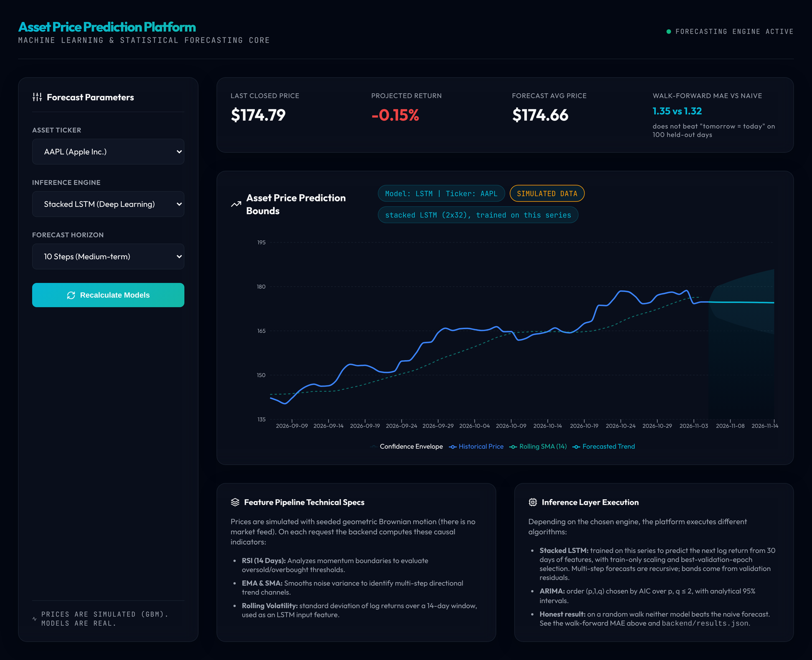
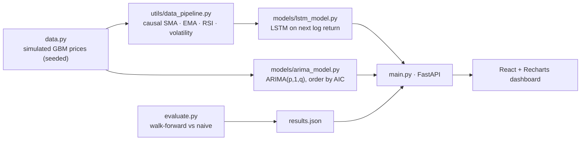
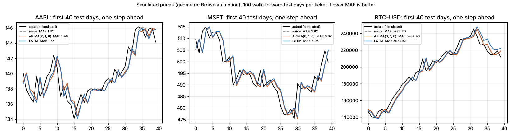

# Asset Price Prediction Platform

A stacked LSTM and an AIC-selected ARIMA, served by FastAPI behind a React dashboard. Both are
evaluated walk-forward against a naive "tomorrow = today" baseline. The prices are **simulated**
(geometric Brownian motion). On that random walk neither model beats naive, and the dashboard
says so.

[](https://github.com/VenkataVinesh/Asset-Price-Prediction-Platform/actions/workflows/ci.yml)




## Quick start

```bash
git clone https://github.com/VenkataVinesh/Asset-Price-Prediction-Platform.git
cd Asset-Price-Prediction-Platform

# Backend (Python 3.10+). CPU is enough.
cd backend
pip install -r requirements.txt
python evaluate.py                 # walk-forward evaluation, writes results.json and docs/evaluation.png (~10 s)
uvicorn main:app --port 8000       # API docs at http://localhost:8000/docs

# Frontend, in a second terminal
cd frontend && npm install && npm run dev     # http://localhost:5173
```

Or `docker-compose up --build` from the repo root. Tests: `cd backend && pip install -r
requirements-dev.txt && pytest -q`.

## How it works



- **LSTM:** 2 layers × 32 units. Input is a 30-day window of [log return, RSI/100, 14-day
  volatility]; the target is the next log return.
  - Chronological split. The scaler is fitted on training rows only and saved with the weights.
  - The last 15% of training rows are validation: they pick the best epoch and give the residual
    spread that sets the band (±1.96 σ √h in log space).
  - Multi-step forecasts are recursive. The model is trained on first request per ticker and cached.
- **ARIMA:** (p,1,q) with p, q ≤ 2, chosen by AIC, with an analytical 95% interval. If a fit fails,
  the API returns an error. There is no invented fallback.
- **Every response** carries `"simulated": true` and a `data_source` string, and the UI shows a
  SIMULATED DATA badge.

## Results

`python evaluate.py`: fit on the first 400 of 500 simulated days, then predict each of the last
100 days using only earlier prices.

| Ticker | Naive MAE | ARIMA MAE (order) | LSTM MAE | LSTM directional hit-rate (n = 100, ±9.8pp) |
|---|---:|---:|---:|---:|
| AAPL | **1.32** | 1.40 (2,1,0) | 1.35 | 38% |
| MSFT | **3.92** | **3.92** (0,1,0) | 3.98 | 46% |
| BTC-USD | **5,784** | **5,784** (0,1,0) | 5,982 | 51% |



Reading it: on a random walk the best forecast *is* the last price. AIC agrees and picks
ARIMA(0,1,0), which is the naive model, on two of three series. The LSTM lands within a few percent
of naive and never below it. Its hit-rates sit around 50%. AAPL's 38% is outside the ±9.8pp band
for one seed, but on data with no signal that is noise in the other direction, not a learned
anti-signal. This is the expected result, and the harness's job is to show it rather than hide it.

## Limitations

- **No real market data.** `data.load_csv()` accepts a `date,close` file, but no real series has
  been evaluated here. Any claim about real prices would need that run first.
- A single seed for the LSTM in the evaluation, a 100-day test window, and no hyperparameter search.
- Recursive multi-step LSTM forecasts reuse the model's own outputs, so their bands assume
  independent errors.

## Project layout

```
backend/
  data.py               simulated prices (+ CSV loader)
  utils/data_pipeline.py   causal indicators
  models/lstm_model.py  LSTMForecaster: fit, one-step, recursive forecast, save/load
  models/arima_model.py AIC order selection, forecast, causal one-step predictions
  evaluate.py           walk-forward evaluation -> results.json, docs/evaluation.png
  main.py               FastAPI: /api/forecast, /api/evaluation, /api/tickers
  tests/                pytest: causality, train-only scaling, AIC, API labelling
frontend/               React + Vite + Recharts dashboard
```

## License

MIT, see [LICENSE](LICENSE).
